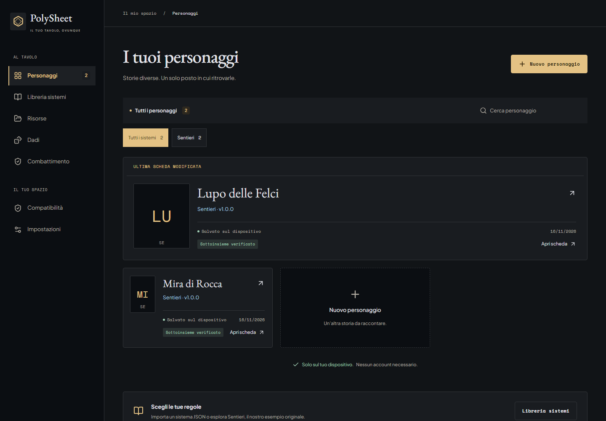

# PolySheet

[](LICENSE.md)

A local-first character notebook for tabletop RPG players who want their sheets,
notes and dice in one place, even without a connection. Import a system, create
characters manually and keep your table's records in your browser.

[Try the app](https://camiu01.github.io/PolySheet/) ·
[Try Sentieri](#try-it-with-sentieri) ·
[Documentation](docs/README.md) ·
[Contributing](CONTRIBUTING.md)



*Desktop character library, captured from a local production test on 2026-11-16.
The characters and Sentieri content are original examples, not external game content.*

## What it does

- Keep multiple characters and immutable system versions. Supported sheet
  components come from the imported definition; edits recalculate supported formulas.
  Unused versions can be removed with confirmation; character/encounter pins block deletion.
- Discover systems from a public GitHub source repository and retrieve class,
  race/ancestry, background and heritage catalogs. Select the compiled system file once,
  then reuse the local version. [Import guide](docs/GITHUB_IMPORT.md#source-repositories-and-automatic-catalogs).
- Import an exported folder with the system and its `catalogs/` in one review.
  Non-system files such as PDFs are ignored without being read.
- Assign private background/origin graphs and choose source-declared subraces
  by name, retaining their original IDs without applying automatic effects.
- In **Risorse**, import supported catalogs from a JSON link, a GitHub folder
  or a web folder with `index.json`. [Link formats](docs/VIEWS.md#resource-links).
- Manage local resources and notes, typed references, scalar lists and local
  PNG/JPEG photos. Notebook links alone do not equip items or activate rules.
- Roll manual dice with saved history. Track source-defined encounters,
  initiative, turns and rounds within the [combat subset](docs/COMBAT.md).
- Work offline after the first production load and worker activation. Export
  backups and exact original system files, including supported `.rpg` uploads.
- Use the charcoal/brass interface on desktop or phone, with local fonts,
  dark by default, an optional light theme and centered dialogs.

PolySheet is independent of RPG Companion App. It implements a declared subset,
not its complete rules engine or official character-creation flow.

## Try it with Sentieri

Open the [hosted app](https://camiu01.github.io/PolySheet/) or run it locally:

1. Open **Libreria sistemi** and choose **Esplora Sentieri**.
2. Review the preview, then choose **Conferma importazione**.
3. Return to **Personaggi**, choose **Nuovo personaggio**, select Sentieri,
   enter a name and choose **Crea personaggio**.
4. Open the sheet. Vigore starts at 2, Ingegno at 3, Istinto at 1 and Scorte at 6.
   Change Vigore to 7 and leave the field: calculated Slancio changes from 3 to 8.
5. Wait for saving to finish. In a production build, wait for the offline-ready
   notice before trying an offline reload.

Sentieri is a small original MIT-licensed example, included without downloads or
third-party game rules. The hosted demo may differ from your local checkout;
[verification](docs/VERIFICATION.md) records what was actually checked.

## Run locally

Use Node.js 22.12+ or 24 LTS and npm. From the repository root:

```sh
npm ci
npm run dev
```

Open the address printed by Vite. No backend, account, API key or environment
file is required. Development mode does not enable the production offline worker.

| Command | Purpose |
| --- | --- |
| `npm run dev` | Start the local development server |
| `npm run check` | Check TypeScript and run Vitest |
| `npm run build` | Build the static PWA in `dist/` |
| `npm run preview` | Serve the production build locally |
| `npm run test:e2e` | Test the production build on desktop and emulated mobile |

See [development and testing](docs/DEVELOPMENT.md) for browser setup, isolated
ports, optional external fixtures and the complete command list.

## Before importing a system

Monolithic JSON and the verified gzip-JSON **system** `.rpg` variant can be
previewed from a file, HTTPS URL or a folder chosen with the browser's directory
picker. A folder may also carry catalog JSON under `catalogs/` or
`resource_instances/`; both are reviewed and installed after one confirmation.
Browsers cannot read a typed `C:\...` path, so the folder must be selected.
Public GitHub repository roots also support
[commit-pinned file discovery](docs/GITHUB_IMPORT.md).

Decoding a file, validating its definition, supporting its formulas/views/events
and being able to use it at the table are four different checks.
Read the [compatibility guide](docs/COMPATIBILITY.md#reading-import-results)
and review the app's diagnostics before relying on an external system.

- 5e, 5e2024 and PF2e packages remain partially supported, not complete playable
  implementations. Unsupported rules stay visible.
- Split authoring directories, RPGScript `.rpgs`, distribution indexes and
  book/class/race resource archives are not compiled or decoded. Supported
  source metadata and individual catalog JSON files are handled separately.
- General events, lifecycle effects, automatic progression and equipment
  mechanics are not implemented. Manual creation and supported edit forms do
  not execute the original creation workflow.
- System inputs are limited to 8 MiB, independently for compressed and expanded
  data. Gzip decoding needs native browser `DecompressionStream`.
  See [all safety limits](docs/ARCHITECTURE.md#safety-limits).

## Your data and offline use

There is no backend, account, analytics or automatic sync. Data belongs to the
current browser profile and origin. Private browsing, storage eviction or
clearing site data can remove it. Browser data and exported backups are not encrypted.

Use **Impostazioni → Esporta backup** regularly. A restore validates the backup
and asks before replacing the entire local archive. Backups use PolySheet v3;
v1/v2 can also be restored, but older apps cannot restore v3. This is not an
RPG Companion character-export format.

Offline use starts after a successful production load and service-worker
activation. Remote images are never fetched. Finish editing and wait for
**Salvataggio in corso…** to disappear before reloading or accepting an update.
Moving between localhost, the demo and a custom domain requires an explicit
backup/export and restore, not a deployment.

## Documentation and contributions

Start with the [documentation index](docs/README.md):

- [Source views and manual editing](docs/VIEWS.md)
- [Compatibility and source evidence](docs/COMPATIBILITY.md)
- [Executed checks and known gaps](docs/VERIFICATION.md)
- [Architecture and data boundaries](docs/ARCHITECTURE.md)
- [Static hosting, CI and Pages](docs/CI_CD.md)

Contributions are welcome. Read [CONTRIBUTING.md](CONTRIBUTING.md) for setup,
documentation standards and compatibility extension rules. Documentation and
code comments are English; UI copy is Italian, and imported labels stay unchanged.

## Credits and license

PolySheet, Sentieri and the original icons/artwork are [MIT-licensed](LICENSE.md).
Dependency licenses remain their own, including Lucide's ISC license.

External systems, game text and images are not covered by that license and are
not bundled. Unresolved source-license conflicts and local-only fixture
attributions are recorded in [NOTICE.md](NOTICE.md).